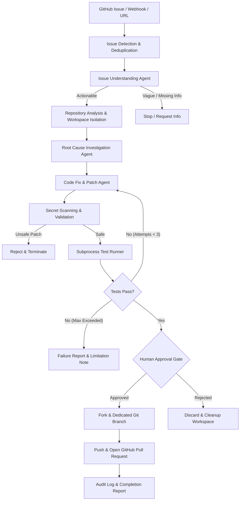

# Autonomous GitHub Issue Resolution Agent

An autonomous, multi-agent AI coding system that works with **any public GitHub repository** to triage, investigate, patch, test, and open Pull Requests for reported issues.

Powered by **Google Gemini API** and orchestrated with **LangGraph**.

---

## 🌟 Key Features

1. **Works with Any Public GitHub Repository**: Accepts repository URLs, issue URLs, `owner/repo` shorthands, or manual issue submissions.
2. **Multi-Agent Architecture**:
   - **Issue Detection Agent**: Detects new/reopened issues and prevents duplicate processing.
   - **Issue Understanding Agent**: Categorizes issues (Bug, Feature, Security, Docs, Enhancement), computes severity & priority, and detects missing information.
   - **Repository Analysis Agent**: Clones repositories into local isolated workspaces, analyzes tech stack and file structures, and discovers test runners.
   - **Root Cause Agent**: Traces code execution and identifies culprit files and suspect functions with concrete evidence.
   - **Code Fix Agent**: Generates unified diffs and precise code fixes adhering to existing conventions.
   - **Testing Agent**: Executes allowlisted test suites (`pytest`, `npm test`, `cargo test`, etc.) in an isolated subprocess with strict timeouts and output limits.
   - **GitHub PR Agent**: Automatically forks public repositories when needed, branches, commits changes, and opens structured Pull Requests referencing the original issue.
3. **Never Automatically Merges**: Enforces a strict security policy ensuring that no generated Pull Request is ever merged automatically into the base branch.
4. **Human-in-the-Loop Approval Gate**: Offers interactive approval in the developer dashboard to review diffs and test logs before opening a PR on GitHub.
5. **Robust Security Boundaries**:
   - Subprocess environment isolation (strips `GEMINI_API_KEY`, `GITHUB_TOKEN`, and cloud credentials).
   - Strict command execution allowlist (denies arbitrary shell scripts, `rm`, `curl`, `wget`).
   - Pre-commit secret scanning (detects private keys, GitHub tokens, AWS keys, API credentials).
   - Prompt injection defense (wraps untrusted issue text and code inside structural delimiters).
   - HMAC-SHA256 signature verification for incoming GitHub webhooks.
6. **Zero External Database Dependency**: Uses local isolated workspaces, Git CLI, and atomic JSON persistence—no Docker, Redis, Celery, or external database required.
7. **Developer Dashboard**: Built with Next.js 14, TypeScript, and Tailwind CSS.

---

## 🏗️ Architecture & Workflow



---

## 📂 Project Structure

```
github-issue-agent/
│
├── backend/
│   ├── app/
│   │   ├── agents/          # Specialized agent implementations
│   │   │   ├── issue_detector.py
│   │   │   ├── issue_analyzer.py
│   │   │   ├── repo_analyzer.py
│   │   │   ├── root_cause_agent.py
│   │   │   ├── code_fix_agent.py
│   │   │   ├── testing_agent.py
│   │   │   └── pr_agent.py
│   │   ├── api/             # FastAPI endpoints and Pydantic schemas
│   │   │   ├── routes.py
│   │   │   └── schemas.py
│   │   ├── config/          # Pydantic BaseSettings
│   │   │   └── settings.py
│   │   ├── github/          # GitHub API, Webhooks, and Git CLI
│   │   │   ├── client.py
│   │   │   ├── git_ops.py
│   │   │   └── webhooks.py
│   │   ├── services/        # Gemini client wrapper and Job runner
│   │   │   ├── llm.py
│   │   │   └── job_runner.py
│   │   ├── storage/         # Isolated workspace manager and JSON store
│   │   │   ├── json_store.py
│   │   │   └── workspace.py
│   │   ├── tools/           # Code search, file editing, and test runner
│   │   │   ├── code_search.py
│   │   │   ├── file_editor.py
│   │   │   └── test_runner.py
│   │   ├── workflows/       # LangGraph state graph and routing
│   │   │   ├── graph.py
│   │   │   └── state.py
│   │   └── main.py          # FastAPI application entrypoint
│   ├── tests/               # Pytest test suite (19 unit & e2e tests)
│   └── pyproject.toml
│
├── frontend/                # Next.js 14 Developer Dashboard
│   ├── app/
│   │   ├── page.tsx         # Dashboard overview & stats
│   │   ├── jobs/[id]/       # Live job inspector, diff viewer, logs
│   │   ├── repos/           # Connected repository manager
│   │   ├── pull-requests/   # Created PR list & audit
│   │   └── layout.tsx
│   ├── components/          # Reusable UI components
│   └── services/api.ts      # Backend API client
│
├── .env.example
└── README.md
```

---

## 🚀 Quickstart Guide

### 1. Prerequisites
- Python 3.12+ (Python 3.14 supported)
- Node.js 18+ and npm
- Git 2.30+

### 2. Configure Environment Variables
Copy `.env.example` to `.env`:
```bash
cp .env.example .env
```
Edit `.env` with your credentials:
```ini
GEMINI_API_KEY=AIzaSy...
GITHUB_TOKEN=ghp_...
GITHUB_WEBHOOK_SECRET=my-webhook-secret
AUTONOMOUS_MODE=false
```
*(Note: If `GEMINI_API_KEY` or `GITHUB_TOKEN` is not yet set, the agent provides deterministic fallback analysis and dry-run PR simulation so you can explore the entire flow locally).*

### 3. Backend Setup
Create virtual environment and install dependencies:
```bash
cd backend
python3 -m venv .venv
source .venv/bin/activate
pip install -e ".[dev]"
```

Run tests to verify installation:
```bash
pytest tests/ -v
```

Start the FastAPI backend:
```bash
python -m uvicorn app.main:app --host 0.0.0.0 --port 8000 --reload
```
API Documentation will be available at [http://localhost:8000/docs](http://localhost:8000/docs).

### 4. Frontend Setup
In a new terminal:
```bash
cd frontend
npm install
npm run dev
```
Open [http://localhost:3000](http://localhost:3000) in your browser.

---

## 📡 REST API Reference

| Method | Endpoint | Description |
|---|---|---|
| `GET` | `/health` | Service health status, version, and aggregate statistics |
| `POST` | `/api/issues/analyze` | Triage and classify an issue without modifying code |
| `POST` | `/api/issues/resolve` | Queue background autonomous resolution job |
| `POST` | `/api/repositories/connect` | Register a public GitHub repository |
| `GET` | `/api/repositories` | List connected repositories |
| `GET` | `/api/jobs` | List recent resolution jobs |
| `GET` | `/api/jobs/{job_id}` | Retrieve job details, diff, test results, and status |
| `GET` | `/api/jobs/{job_id}/logs` | Stream chronological execution logs for a job |
| `GET` | `/api/pull-requests` | List all Pull Requests created by the agent |
| `POST` | `/api/agent/approve/{job_id}` | Approve patch and create GitHub Pull Request |
| `POST` | `/api/agent/reject/{job_id}` | Reject patch and clean up workspace |
| `POST` | `/webhooks/github` | Receive GitHub Webhook events with HMAC verification |

---

## 🛡️ Security Architecture

1. **Subprocess Isolation**: When running tests or checking code, the subprocess environment is explicitly sanitized. All variables matching `*KEY*`, `*TOKEN*`, `*SECRET*`, `*PASS*`, or `*CRED*` are purged before execution.
2. **Command Allowlist**: Only strictly approved commands (`pytest`, `python -m pytest`, `npm test`, `cargo test`, `go test ./...`) can be executed. Shell meta-characters (`;`, `&&`, `|`, `` ` ``, `$()`) are blocked.
3. **Secret Leak Detection**: Before any patch is committed or created, the unified diff is scanned for private keys, GitHub tokens, Google API keys, AWS keys, and generic hardcoded secrets.
4. **Prompt Injection Mitigation**: External text from issues, comments, or repository files is enclosed in `<UNTRUSTED_CONTENT>` XML safety tags with strict system instructions directing the LLM to treat them purely as data.
5. **No Automatic Merging**: PRs are created as standard review requests; automatic merges are explicitly disallowed.

---

## 🧪 Testing

The repository includes a comprehensive test suite covering security, tools, git operations, LangGraph workflows, and end-to-end resolution:

```bash
cd backend
source .venv/bin/activate
pytest tests/ -v
```

All 19 tests run in under 1 second.

# GitHub-Issue-Agent
